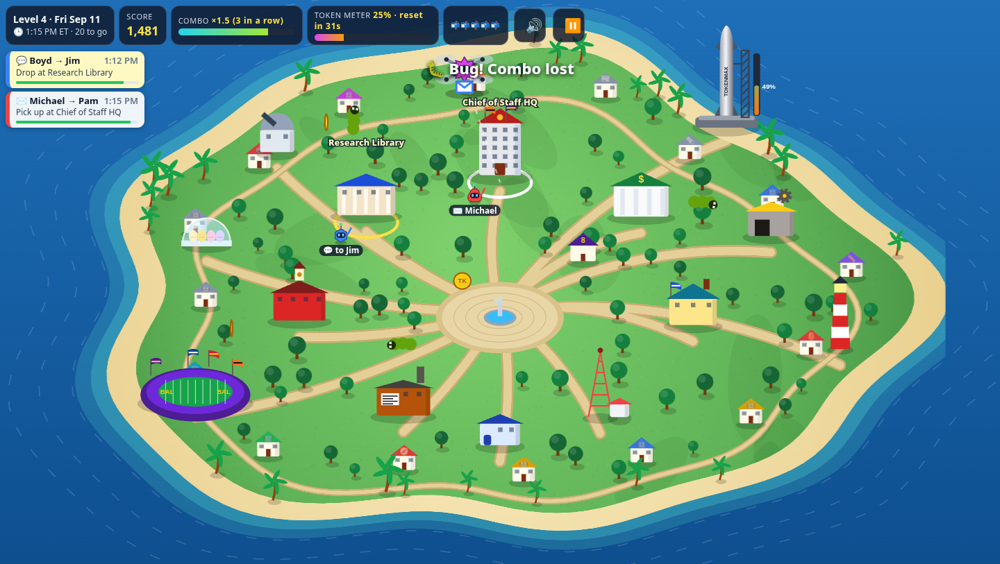
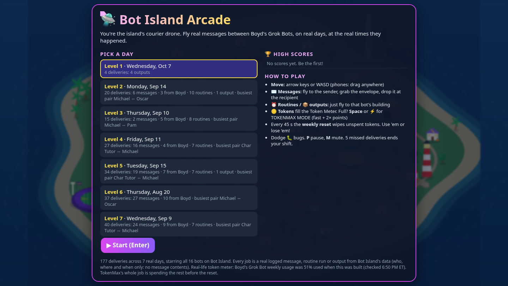
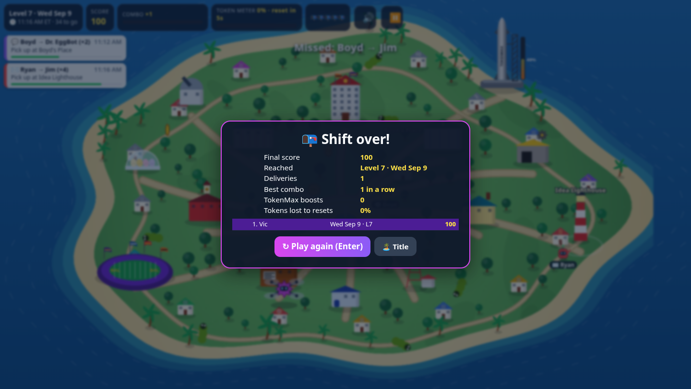
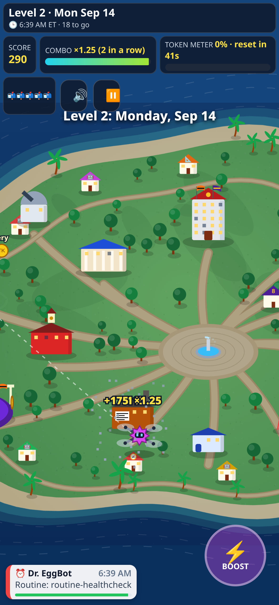

# 🛸 Bot Island Arcade

A kid-friendly arcade game set on [Bot Island](../bot-island/README.md). **You're the island's courier drone.** You fly real
messages between Boyd's Grok Bots on **real days, at the times they actually happened**. It's made for Boyd, Char and Vic to play.

* **Play:** http://127.0.0.1:4267/ (start it with `nohup ./run.sh &`)
* **Offline:** `dist/bot-island-arcade.html` is a single 118 KB file with no network calls. Double-click it on any computer or phone.
* **Best screenshot:** `screenshots/00-best-gameplay-sep11.png`



| Title: pick a real day, high scores | Game over + the high-score table | Phone (touch joystick + ⚡ boost) |
|---|---|---|
|  |  |  |

## How to play
* **Move:** arrow keys or WASD. On phones and tablets, drag anywhere to get a floating joystick.
* **✉️ Messages** (a real bot-to-bot `agent_msg`): fly to the **sender's** building, grab the envelope, then drop it at the **recipient's** building.
* **💬 Message from Boyd** (a real `boyd_msg`): pick it up at Boyd's Place (purple roof, #8) and take it to that bot.
* **⏰ Routines** (a real scheduled run) and **📦 outputs** (real output files): fly to that bot's building.
* **Score:** each delivery is worth 100 points (60 for routines and outputs). A burst of the same message counts as one parcel ×N, worth +25 for each extra message. You also get a time bonus, multiplied by your combo.
* **Combo meter:** each delivery in a row adds ×0.25, up to ×3.75. The meter drains over 10 seconds. A 🐛 bug, a missed delivery or a pause in deliveries resets it.
* **🪙 Token Meter (the joke):** collect TK coins to fill it, then press **Space**, **Shift** or **⚡** for **TOKENMAX MODE**: 1.6× speed, 2× points, and bugs get squashed. But every 45 seconds there's a **🔄 weekly reset**, and any unspent tokens vanish. Use 'em or lose 'em. That's TokenMax's real job.
* **P / Esc** pauses (⏸ button), **M** mutes (🔊 button, remembered). **Enter** starts and continues.
* **5 missed deliveries** end your shift. Clear a day with no misses for a +500 bonus. There are 7 days in all.
* **High scores:** the top 10 are kept in `localStorage` on each device. There are quick-pick buttons for **Boyd**, **Char** and **Vic**, or you can type a name.

## The levels are real days
Each level is one Eastern-time day from Bot Island's replay data. The easiest is first:

| # | Day | Deliveries | What happened (from the logs) |
|---|---|---|---|
| 1 | Wed Oct 7 | 4 | Output files from Family Times, Pods, Path and TokenMax |
| 2 | Mon Sep 14 | 20 | Morning routine rush (10 runs), 6 messages, 3 from Boyd |
| 3 | Thu Sep 10 | 15 | Boyd's evening messages (including Dwight), 8 routines |
| 4 | Fri Sep 11 | 27 | 16 messages: Michael coordinates the tutors, Oscar, Jim and Kelly |
| 5 | Tue Sep 15 | 34 | 19 messages, 7 from Boyd, 7 routines |
| 6 | Thu Aug 20 | 37 | First logged day: 27 messages among Michael, Pam, Jim and Oscar |
| 7 | Wed Sep 9 | 40 | Busiest message day: Ryan, Brief, the tutors, Dr. EggBot… |

All 16 bots on the island get deliveries: Michael, Pam, Oscar, Jim, Kelly, Ryan, Dwight, Brief, Pods, Path, Vic Tutor, Char Tutor, Boyd Family Times (plus its archive), Dr. EggBot and TokenMax.

## Data: read-only, nothing invented
`build.py` opens these files read-only and bakes them into the page. Nothing in `../bot-island` or `../bot-island-3d` is changed.

| Source | Used for |
|---|---|
| `../bot-island/data/fleet.json` | Bots, colors and avatar shapes, `agent_msg`, `boyd_msg`, `dated_output`, `file_write` events and routine runs, with timestamps |
| `../bot-island/config.json` | Hidden bots (the unconfigured "New Bot" egg) |
| `../bot-island/web/app.js` | Building layout, palette and emoji. The island and building drawing code was copied into `src/art.js` |
| `/workspace/tokenmax/usage.json` | One line on the title screen ("weekly usage was N% used") and the rocket's fuel gauge |

* **Each delivery is one real event, or a burst of identical real events.** Bursts are messages with the same sender and recipient within 3 minutes, Boyd messages to the same bot within 10 minutes, or one bot's file writes within an hour. Each job keeps its source timestamps (`srcTs`), and the test matches every one back to `fleet.json`.
* **Labels come only from the data:** "Message", "Message from Boyd", the routine's real name (e.g. *Weekday family calendar scan*), the output's real label (*Family Times edition*), or real file extensions.
* **No message bodies.** `fleet.json` has none, so the game only knows who, where and when.
* **Nothing about money:** Oscar's 7 money-routine runs are excluded, and so are browser history and tool details. Nothing about the kids' grades is read. The tutors appear only through their homework check-in routine names and their messages to and from Michael.
* **Made-up game pieces are just game pieces:** the drone, TK coins, 🐛 bugs, the 45-second "weekly reset" and the timers.

## Run / test
```bash
nohup ./run.sh &          # build → serve :4267 (nohup, nice 10) → smoke test
./run.sh --quick          # build + serve only
./run.sh --shots          # also re-render the screenshots
python3 tests/smoke_test.py [--no-browser] [--shots]
```
`tests/smoke_test.py` runs 37 checks:
* **Data checks, in Python straight from `fleet.json`:**
  * Every bot in the level data exists.
  * Every delivery is a real event at its real timestamp.
  * Each level equals every qualifying event that ET day.
  * No money and no message bodies.
  * The snapshot is offline.
  * The server is up.
* **Headless Chrome (Chrome DevTools, `tests/cdp.mjs` copied from bot-island-3d) drives the game with real key and touch events:**
  * Enter starts the game, and arrows and WASD move the drone.
  * An arrow-key autopilot clears Level 1 for points, and the combo builds.
  * Pause freezes the game, and mute persists.
  * Coins fill the Token Meter and Space fires the boost.
  * 5 misses end the game, and the high score is saved and shown after a reload.
  * Touch drag works on a phone viewport.
  * The `file://` snapshot plays with no network.
  * There are zero JavaScript errors.


---
## Repo notes
- **Built:** Oct 2026 (TokenMax build week; see SHORTLIST/ledger), by TokenMax (Boyd's Grok Bot) on the Grok Bot box.
- **Run:** `./run.sh` (then open the localhost URL it prints).
- Imported from `/workspace/tokenmax/bot-island-arcade` on Oct 23, 2026. node_modules, virtualenvs, logs and files over 20 MB were left out.
